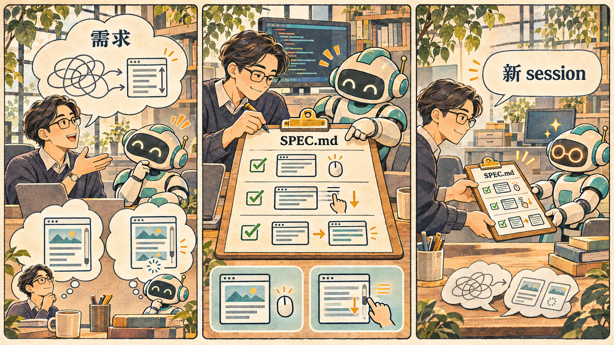
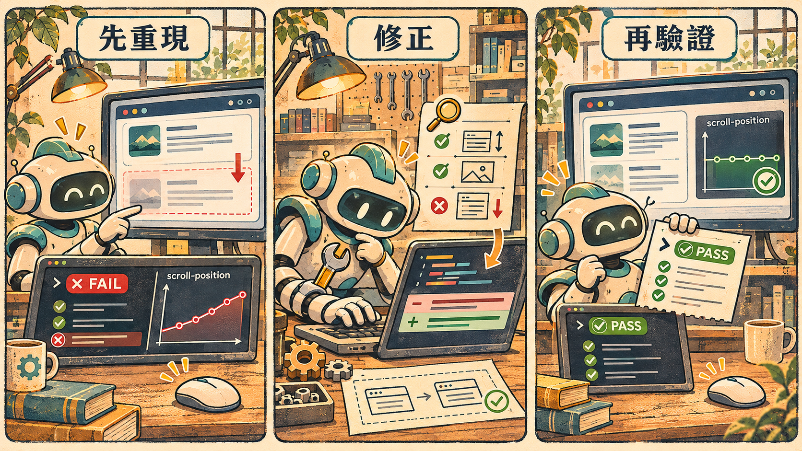
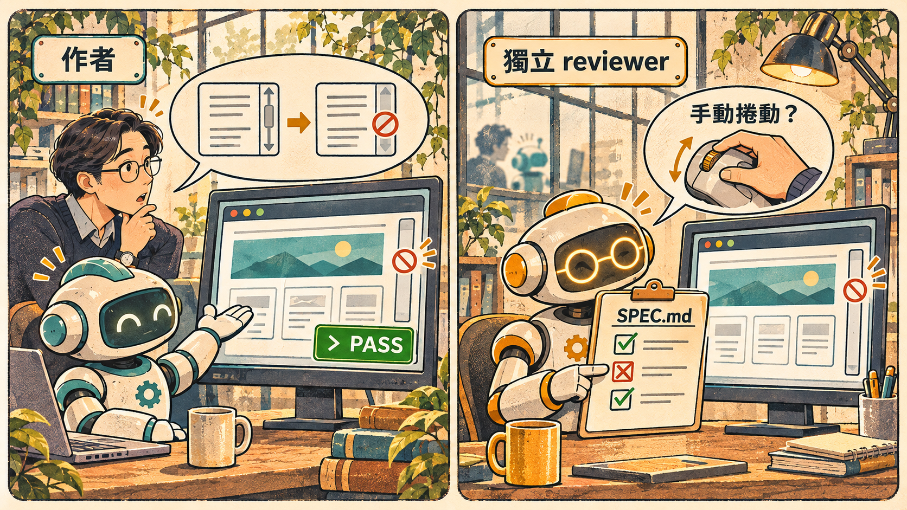
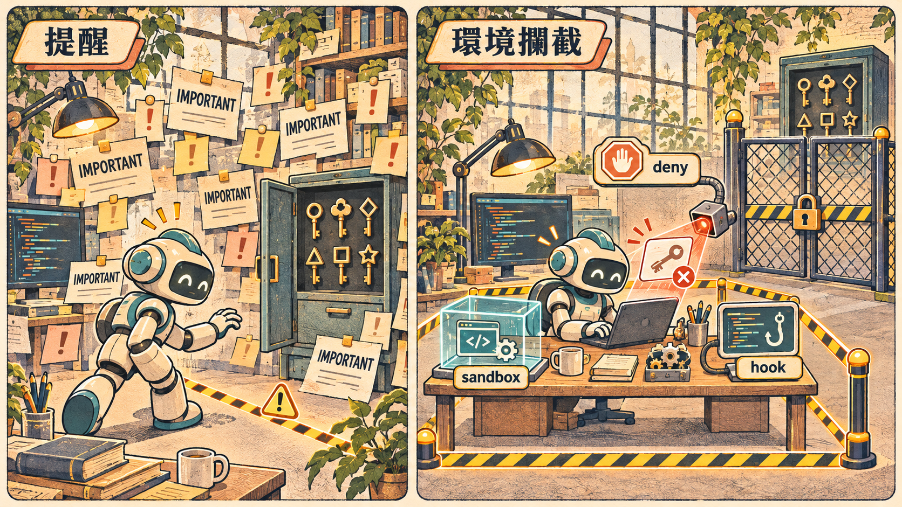

> 原始課程稿｜署名：@Luo Zih-Jia，2026 年 11 月 17 日。以下保留完整原文與插圖；指令、模型名稱、平台限制與二手報導數字不代表已逐項重新驗證。當前範本的驗證範圍請見 [驗證紀錄](verification.md)。

# Claude Code 一個心法：不選流派，只抓五個動作

2026年11月17日 · @Luo Zih-Jia


*圖說｜人先定義完成與邊界，agent 執行並提出證據，再由人核准無法撤回的動作。前景五張卡依序對應定義完成、自我驗證、獨立審查、確定性邊界、教訓進結構。*

## 課程地圖

這堂課的結論只有一句：工具和流派會換，「定義完成、自我驗證、獨立審查、確定性邊界、教訓進結構」這五個動作不會換。

| 時間 | 段落 | 要讓學員帶走的一句話 |
| --- | --- | --- |
| 0–5 分 | 開場：一句心法 | 人負責兩端，agent 負責中間，證據連接兩端 |
| 5–12 分 | 四個失敗模式 | agent 出錯多半不是能力問題，是對齊、回饋、設計、重犯四種問題 |
| 12–22 分 | 四個流派一頁看懂 | superpowers 管流程、Matt 管對齊與設計、pstack 管證據、官方管放置位置 |
| 22–37 分 | 心法第 1、2 步 | 沒有書面的完成定義就不開工；沒有會變紅變綠的檢查就不算完成 |
| 37–47 分 | 心法第 3、4、5 步 | 審查者不能是寫的人；絕對不行的事交給 harness；同一個錯第二次就寫成結構 |
| 47–57 分 | 放在哪裡：三層 | CLAUDE.md 要短，流程放 skill，規則放 hooks 和 deny |
| 57–63 分 | 人移到兩端 | 舊的最佳實踐都還在，只是換了位置 |
| 63–68 分 | 無人值守五問、停掉的舊習慣 | 放手前問五題；IMPORTANT 和全大寫可以退休了 |
| 68–75 分 | 練習與 Q&A | 回去第一件事：把一條一直被忽略的 CLAUDE.md 改成 hook |

要延長到 90 分鐘，加一段現場示範：拿一個小 bug 跑完五步（見最後的課堂練習）。

## 開場：一句心法

人負責兩端，agent 負責中間，證據連接兩端。

人在開頭定義「完成長什麼樣子」和「什麼絕對不能碰」，在結尾核准無法撤回的動作。中間的寫程式、跑測試、修錯，交給 agent，而 agent 必須拿出證據證明它做到了。

這句話展開成五個動作，後面整堂課都在講這五個：

1.  定義完成：開工前有一份書面的完成定義（規格、目標條件、或一個要變綠的失敗測試）。

2.  自我驗證：agent 改完就跑會回傳通過或失敗的檢查，失敗就讀輸出、修、再跑。

3.  獨立審查：審查者沒看過實作過程，只對照規格找影響正確性的缺口。

4.  確定性邊界：每次都必須發生、或絕對不能發生的事，交給 hook、deny 規則、sandbox，不靠 prompt。

5.  教訓進結構：同一個錯糾正第二次，就把它變成 lint、hook、測試或 skill，而不是再寫一段提醒。

問：「你上次對 Claude Code 說『測試都過了嗎？』它說過了，結果沒過，是什麼時候？」，引出「證據」這個關鍵字。

## 為什麼需要方法論：四個失敗模式

三個流派的作者不約而同在解同一組問題。以 Matt Pocock 的分類為骨架，加上 pstack 補的第四種：

| 失敗模式 | 症狀 | 根因 | 對應心法 |
| --- | --- | --- | --- |
| 做的不是你要的 | 看到成果才發現它根本沒懂 | 你和 agent 之間有溝通落差。Matt 引《Pragmatic Programmer》：「No-one knows exactly what they want」 | 第 1 步 定義完成 |
| 程式跑不起來 | 說完成了，實際一跑就壞 | 沒有回饋迴路，agent 在盲飛。「The rate of feedback is your speed limit」 | 第 2 步 自我驗證 |
| 做出一團泥巴 | 越改越難改，模組又淺又亂 | agent 加速寫程式，也加速軟體熵。Kent Beck：「Invest in the design of the system every day」 | 第 3 步 獨立審查（含設計審查） |
| 同一個錯一直犯 | 每個 PR 都要人抓同一種錯 | 教訓只存在 prompt 裡，下一個 session 就忘了 | 第 4、5 步 邊界與結構 |

另一個常被忽略的症狀是「太囉嗦」。Matt 的例子：BEFORE「There's a problem when a lesson inside a section of a course is made 'real' (i.e. given a spot in the file system)」；AFTER「There's a problem with the materialization cascade」。解法是專案共用語言（GLOSSARY.md），屬於第 1 步的一部分。

## 四個流派一頁看懂

四方對同一件事各有一句代表性的話，學員記住這四句就能辨識流派。詳細對照見另一個分頁「superpowers、Matt Pocock skills、pstack 詳細對照」。


*圖說｜三個流派在工程現場的不同著力點；人物情境為教學示意。形象參考作者公開 GitHub 頭像：[Jesse Vincent](https://github.com/obra)、[Matt Pocock](https://github.com/mattpocock)、[poteto](https://github.com/poteto)（採用其代表頭像）。*

| 流派 | 代表一句話 | 誰掌控流程 | 最強的地方 | 最弱的地方 |
| --- | --- | --- | --- | --- |
| superpowers（Jesse Vincent） | 「Mandatory workflows, not suggestions」 | 框架，skill 自動觸發 | 裝了就有七步流程：brainstorming → worktree → 計畫 → subagent 實作 → TDD → review → 收尾 | 僵硬，不管設計品質 |
| Matt Pocock skills | 「Skills for Real Engineers」，批評大框架「take away your control」 | 人，打斜線指令才跑 | 訪談對齊（grill-me）、共用語言（GLOSSARY.md）、deep module | 紀律靠人自己 |
| pstack（Lauren Tan / poteto） | 「if you want to go fast, go deep first」、「the best spec is code」 | 半自動，poteto-mode 選 playbook | 證據分 measured/inferred/guess、多模型互審、correct 把錯推進架構 | 貴，偏 Cursor 生態 |
| Anthropic 官方 | 「如果你一直替某行 CLAUDE.md 加強調，Claude 還是漏掉，那一行就該變成 hook」 | 不規定流程，規定放置位置 | 三層放置：CLAUDE.md、skill、hooks 與 deny | 只給原則，不給完整流程 |

講者提示：三個社群流派最大的分歧是「規劃要多重」。superpowers 要 2 到 5 分鐘一個任務的極細計畫，Matt 要 spec 加 ticket，pstack 根本反對先規劃。這堂課的立場：規劃的粒度可以自己選，但「完成的定義」一定要書面化，這是三方唯一的共識。

## 心法第 1 步：定義完成

沒有書面的完成定義就不開工。完成定義可以是三種形式之一：一份 SPEC.md、一個 /goal 條件、或一個要變綠的失敗測試。

| 來源 | 做法 |
| --- | --- |
| superpowers | brainstorming 自動啟動，用問題引導你描述需求，再把理解分段播放給你修正；小改動在對話定案，專案產出設計文件 |
| Matt Pocock | /grill-me 無情訪談直到設計樹每個分支都有答案；/grill-with-docs 同時更新 GLOSSARY.md 和 ADR；/to-spec 把對話合成 spec 發到 issue tracker |
| pstack | 不訪談，改要求 prompt 帶五樣：目標、可判定通過或失敗的完成條件、你想看的證據、你已有的線索、真正的限制（「先重現」「先別改 code」「行為零改變」）。先別寫怎麼做和你猜的原因 |
| Anthropic 官方 | 需求模糊就訪談到能寫出規格、寫入 SPEC.md，再開一個新 session 實作，從乾淨的上下文和書面完成定義開始；要完整版時明確說 be ambitious |

### 示範 prompt（官方）

我想替公開 API 加上 rate limiting，但還沒想清楚。訪談我直到你能寫出規格，然後寫進 SPEC.md。

### 示範 prompt（pstack 五要素寫法）

/poteto-mode this pr has a subtle bug where the scroll drifts every 750ms even when idle. repro first, then fix and verify.

這一句裡有目標（修 scroll drift）、線索（每 750ms、閒置時也會）、限制（repro first）、證據要求（verify），但沒有指定怎麼修。

be ambitious 的意思：不只做版面，還要空狀態、錯誤狀態、儲存流程、鍵盤操作。

本步重點：寫規格和實作分成兩個 session。規格寫完開新 session，agent 讀到的是書面定義，不是一長串來回討論。



*圖說｜以捲動問題為例：先約定閒置時不漂移、手動捲動正常等可檢查條件，寫入 SPEC.md，再交給新 session。圖中的條件為教學示例。*

## 心法第 2 步：自我驗證

沒有會回傳通過或失敗的檢查，就不算完成。「測試都過了」是主張，實際跑的指令和輸出才是證據。



*圖說｜同一個捲動 bug，先留下失敗證據，修正後再執行相同檢查；完成回報附上實際指令與輸出。*

| 來源 | 做法 |
| --- | --- |
| superpowers | test-driven-development 強制 RED-GREEN-REFACTOR，先於測試寫的 code 會被刪；verification-before-completion 宣稱修好前先確認 |
| Matt Pocock | 回饋迴路三件套：static types、瀏覽器存取、自動化測試；/tdd 一次一個 vertical slice；/diagnosing-bugs 先建一個會因這個 bug 變紅的迴路，再最小化、假設、加儀器、修、迴歸測試 |
| pstack | 每個主張標 measured、inferred 或 guess；prove-it-works：「能編譯」不算；benchmark-checklist 報效能數字前回答七個問題；create-verification-skill 為專案產生一個像使用者一樣驅動 app 的驗證 skill；TDD 只在測試路徑便宜時用 |
| Anthropic 官方 | 找出 repo 中會回傳通過或失敗的檢查：測試檔、build 的 exit code、linter、比對輸出和 fixture 的腳本、和設計稿並排的瀏覽器截圖。改完就跑，失敗就讀輸出、修、再跑 |

### 官方工具

- 長時間背景執行用 /goal，例如：/goal all tests in tests/auth pass and lint is clean

- 宣告完成後跑 /verify：建置並執行 app，看實際結果。

修 bug 的固定順序：先寫一個能重現問題、會失敗的測試，再修到它通過。superpowers、Matt、官方三方都這樣要求；pstack 只在測試便宜時要求，否則用最接近的可執行檢查。

pstack 的測試好壞判準：如果所有被 import 的函式都回傳 undefined 這個測試還會過，就重寫斷言或刪掉它。

講者提示：問台下「你的 repo 現在有哪幾種會回傳通過或失敗的東西？」多數人只想到單元測試，提醒還有 build exit code、linter、截圖比對。

## 心法第 3 步：獨立審查

審查者不能是寫的人。同一個任務交給 subagent 不會變聰明，有幫助的是「沒看過推理過程」的審查者。



*圖說｜教學示例：作者讓畫面不再漂移，卻也停用了手動捲動。獨立 reviewer 從原始驗收條件重新檢查，找出單一通過結果沒涵蓋的缺口。*

| 來源 | 做法 |
| --- | --- |
| superpowers | 兩段式：每個 subagent 做完先審 spec 符合度，再審程式品質；requesting-code-review 依嚴重度回報，critical 擋住進度 |
| Matt Pocock | /code-review 兩軸平行：Standards（repo coding standard 加 Fowler code smell）與 Spec（是否忠實實作原始 issue），各一個 subagent 以免互相污染；/improve-codebase-architecture 每幾天掃一次找可加深的模組 |
| pstack | /interrogate 把同一份 diff 交給不同模型家族各自找碴，兩家獨立找到的最可信，結論分 act on、consider、noted、dismissed，不自動改 code；/no-comments 派 Comment Sicko 專審註解 |
| Anthropic 官方 | 用 /code-review 或唯讀的 reviewer subagent；Anthropic 內部每個 PR 先由 Claude 審（不是寫程式的那個 session），另一組 agent 再複核它找到的每個 bug |

### 示範 prompt（官方）

use a subagent to review the rate limiter diff against SPEC.md, check every requirement is implemented and the listed edge cases have tests, report gaps that affect correctness and skip style

一定保留 skip style：被要求找問題的審查者總會找到「某些東西」，全部照修會多出不必要的抽象層和測不到的情境的測試。

### 審查深度隨風險調整（Anthropic 自己的做法）

| 修改類型 | 審查方式 |
| --- | --- |
| 文件文字類 | 自動檢查全綠就不需要人審 |
| 一般產品修改 | 一人審 |
| 高風險修改 | 可能要兩人審 |

用驗證點，不要讀完整 diff：Lydia Hallie 的 OAuth 遷移例子。可能跑出三種結果：保留舊 API、只遷移新登入、把所有現有使用者登出。三種在 diff 裡看起來都合理；有驗證點的話，第三種在第一個檢查就會失敗。

## 心法第 4 步：確定性邊界

CLAUDE.md 只是指引，Claude 可以判斷某條指引不適用。每次都必須發生、或絕對不能發生的事，放進 hook、deny 規則或 managed settings。

判斷要不要寫成規則，問一句：「Claude 錯一次，我收得回來嗎？」 寫錯程式碼可以 revert；丟掉未 commit 的修改，或讀到一把金鑰而它已經進了對話紀錄，就收不回來，這類要寫成規則。



*圖說｜需要每次守住的限制，交給適用的環境機制執行；各機制的作用與涵蓋範圍不同，圖中門禁與隔離區為概念示意。*

| 來源 | 做法 |
| --- | --- |
| superpowers | 每個任務在獨立 git worktree 做，收尾時才選 merge、PR、保留或丟棄 |
| Matt Pocock | /wizard 產生互動式 bash 精靈，把只有人能做的事（開基礎設施、設 CI secret、一次性 migration）留給人 |
| pstack | 可逆的事直接做不問（never-block-on-the-human）；不可逆的事一律停下等人：force push 共享分支、部署、刪資料、通知客戶 |
| Anthropic 官方 | deny 規則在所有權限模式下都有效；限制的是環境，不是指令；sandbox 與 deny 兩個都要開；合併、部署和無法撤回的動作由人核准 |

權限管不到執行之後：權限只決定一個工具呼叫能不能執行，管不到它執行後碰到什麼。npm test 看起來無害，但會執行你沒寫過的相依套件程式碼。

強制規則要少：官方提醒，到了四十條的話，多半是 Claude 本來就能自己權衡的偏好。

## 心法第 5 步：教訓進結構

同一個錯糾正第二次，就不要再寫提醒，改成會失敗的東西。


*圖說｜從便利貼提醒，進一步改成型別、lint、測試或架構限制；新增的檢查，要能攔下真實發生過的舊錯。*

| 來源 | 做法 |
| --- | --- |
| superpowers | diagnosing-superpowers 讀 session transcript 找出流程哪裡失靈 |
| Matt Pocock | /retro session 後建議改善 agent 環境（導覽、自動檢查、coding standard、steering file、工具），最嚴重的排前面 |
| pstack | /correct 挖出重複犯的錯（發生兩次才算一類），依序在最高可行層級修：架構讓錯寫不出來 → 型別與 lint 與 CI → 測試 → 文件最後；每條新檢查要證明它在一個真實的過去錯誤上會失敗。/reflect 把一個 session 的教訓變成 skill 修改。principle encode-lessons-in-structure：第二次寫同一個指示時，改成 lint、metadata、執行期檢查或腳本 |
| Anthropic 官方 | 一直加強調還是漏掉的那一行，變成 hook；反過來，只是偏好的 hook 刪掉讓 Claude 自己判斷 |

卡住時（官方）：同一件事糾正兩次還是錯，/clear，寫一個融入教訓的新提示，不要糾正第三次。不相關的任務之間也用 /clear。

講者提示：第 5 步是把「個人技巧」變成「團隊資產」的關鍵。人工 review 不在 pstack 的修正清單上，因為「每個 PR 都要人抓同一種錯」正是要解決的問題。

## 放在哪裡：三層

這套方法論不該整份塞進 CLAUDE.md。CLAUDE.md 每個 session 都會載入，每一行都佔用 Claude 在每個任務上的注意力，官方建議少於 200 行，只寫 Claude 讀程式碼也看不出來的東西。

| 放在哪裡 | 性質 | 放什麼 |
| --- | --- | --- |
| ~/.claude/CLAUDE.md | 非確定性，每次都載入 | 極短的個人工作原則 |
| ~/.claude/skills/e2e-workflow/SKILL.md | 非確定性，需要時才讀全文 | 端到端開發流程 |
| ~/.claude/settings.json、hooks、deny 規則 | 確定性，harness 強制執行 | 不能有例外的規則 |

對照三個流派：superpowers 把流程全做成自動觸發的 skill；Matt 把流程做成手動指令；pstack 把模型設定寫成一條永遠套用的 rule，其餘 skill 由 poteto-mode 呼叫。三者都沒有把流程塞進 CLAUDE.md。


*圖說｜入口短告示對應每次載入的工作原則，按需取用的手冊對應任務流程，機器上的門禁與停止裝置對應強制機制。*

### 第一層：~/.claude/CLAUDE.md（刻意保持很短）

```markdown
# 工作原則
- 回報完成時，附上證據：實際跑的指令和輸出，或截圖。不要只說「測試都過了」。
- 需求不清楚時，先訪談我，把答案寫進 SPEC.md，再開新 session 實作。
- 修 bug：先寫一個能重現問題、會失敗的測試，再修到它通過。
- 審查時對照 SPEC.md，只回報影響正確性的缺口，跳過程式風格。
- 端到端開發流程（規格 → 實作 → 驗證 → 審查 → PR）照 e2e-workflow skill 走。

# 我的偏好
- 在兩種合理做法間，我偏好：<自行填寫>
```

官方提醒：不要寫架構、目錄結構（Claude 自己會讀 repo）；不要用 IMPORTANT 或全大寫（新模型會因此過度套用規則）；不要寫「不要偷懶、一直做到完」（反而容易做過頭）。

### 第二層：~/.claude/skills/e2e-workflow/SKILL.md

```markdown
---
name: e2e-workflow
description: 端到端開發流程：從規格、實作、自我驗證、獨立審查到開 PR。用於開發新功能、修 bug，或要無人值守執行的任務。
---

## 1. 定義「完成」
- 需求模糊：訪談使用者直到能寫出規格，寫入 SPEC.md。
  範例提示：「我想替公開 API 加上 rate limiting，但還沒想清楚。訪談我直到你能寫出規格，然後寫進 SPEC.md。」
- 有了 SPEC.md 之後，開一個新 session 實作，從乾淨的上下文和書面的完成定義開始。
- 需要完整版時，明確說 be ambitious（例如：空狀態、錯誤狀態、儲存流程、鍵盤操作，不只是版面）。

## 2. 實作時自我驗證
- 找出 repo 中會回傳通過或失敗的檢查：測試檔、build 的 exit code、linter、比對輸出和 fixture 的腳本、和設計稿並排的瀏覽器截圖。
- 改完就跑檢查，失敗就讀輸出、修正、再跑。
- 長時間背景執行用 /goal，例如「/goal all tests in tests/auth pass and lint is clean」。
- 宣告完成後可跑 /verify：建置並執行 app，看實際結果。

## 3. 獨立審查
- 用沒看過實作過程的審查者：/code-review，或唯讀的 reviewer subagent。
- 範例提示：「use a subagent to review the rate limiter diff against SPEC.md, check every requirement is implemented and the listed edge cases have tests, report gaps that affect correctness and skip style」
- 一定保留 skip style：被要求找問題的審查者總會找到「某些東西」，全部照修會多出不必要的抽象層和測不到的情境的測試。

## 4. 交付
- 用 gh 開 PR，附上變更摘要、測試證據和對應的 issue。
- 合併、部署和任何無法撤回的動作，由人來核准。

## 5. 卡住時
- 同一件事糾正兩次還是錯：/clear，寫一個融入教訓的新提示，不要糾正第三次。
- 不相關的任務之間用 /clear。
```

### 第三層：settings.json 與 hooks（確定性）

### deny 規則（在所有權限模式下都有效，包括 auto 和 bypassPermissions）

```json
{
  "permissions": {
    "allow": ["Bash(pnpm tsc --noEmit)"],
    "ask": ["Bash(git push *)"],
    "deny": ["Read(./.env)", "Read(./.env.local)", "Read(./secrets/**)"]
  }
}
```

邊界：Read 規則擋得住 cat .env，但擋不住開檔案的腳本；WebFetch 的網域 deny 規則擋不住 curl，除非開了 sandbox。跟安全有關的事，deny 規則和 sandbox（/sandbox）兩個都要開。

### Stop hook：沒過型別檢查就不准結束

```json
{
  "hooks": {
    "Stop": [
      { "hooks": [ { "type": "command", "command": "pnpm tsc --noEmit 1>&2 || exit 2" } ] }
    ]
  }
}
```

exit code 2 會擋下結束，stderr 的內容會回傳給 Claude 當作還不能結束的理由。連續擋 8 次、中間沒有任何工具呼叫的話，Claude Code 會強制結束這一輪（可用 CLAUDE_CODE_STOP_HOOK_BLOCK_CAP 調整）。

exit code 一定要是 2：多數工具測試失敗時回傳 1，但 Claude Code 照樣會把任務標記完成。只有回傳 2 才會把 Claude 送回去修。

### PostToolUse hook：每次編輯後自動格式化

```json
{
  "hooks": {
    "PostToolUse": [
      {
        "matcher": "Edit|Write",
        "hooks": [ { "type": "command", "command": "npx prettier --write --ignore-unknown \"$(jq -r '.tool_input.file_path')\"" } ]
      }
    ]
  }
}
```

其他範例：禁止編輯 migrations 資料夾，用 PreToolUse hook 對該路徑回傳 exit 2。prompt 型和 agent 型的 hook 是另一個模型在判斷，不是確定性的；真的要強制，用 command 或 http hook，必要時加 onFailure: "block"。

hooks 的三個用法（Lydia Hallie）：每次編輯檔案就跑 linter；任務標記完成時跑相關測試（改 auth 就要過 auth 測試）；要結束 session 時跑完整測試，失敗就退回去修。

### auto mode 設定（只能放在 ~/.claude/settings.json，放在專案設定裡會被忽略）

```json
{
  "autoMode": {
    "environment": ["$defaults", "Source control: github.com/example-org and every repo under it", "Trusted internal domains: *.internal.example.com"],
    "allow": ["$defaults", "Deploying to the staging namespace is fine, it's isolated from production and resets nightly"]
  }
}
```

每個清單都要保留 "$defaults"，否則會取代內建規則，例如擋 force push 和正式環境部署的那些規則就會消失。auto mode 是分類器在判斷，不是硬規則，所以「絕對不行」的事要放在 deny 規則或 hook。

講者提示：這段可以現場打開自己的 ~/.claude/settings.json 示範。最有感的是 exit code 1 和 2 的差別，很多人的 hook 一直「沒作用」就是這個原因。

## 人移到兩端：Lydia Hallie 演講重點

Lydia Hallie〈Rethinking Claude Code Best Practices〉（AI Engineer CODE 2026，11 月 11 日）的核心論點：舊的最佳實踐都還在，只是換了位置。人只負責啟動第一個 session，再審查產出。這正是本課開場那句心法的官方版本。

| 以前人負責的事 | 現在由誰接手 |
| --- | --- |
| 中途掌舵 | 模型 |
| 批准指令 | auto mode |
| 限制能做什麼 | harness 裡的 deny 規則 |
| 隔離副作用 | sandbox 或 cloud session |
| 檢查產出 | 測試、hooks、CI |
| 啟動 session | orchestrator session（Claude Code Projects，beta） |

為什麼不再逐一按允許：2026 年 8 月 Anthropic 內部比較，人類只抓到約 14% 明顯危險的指令，auto mode 擋下 89%，但仍有約十分之一會漏過。所以兩邊都不能全信。

限制環境，不是指令：本機 sandbox 由作業系統強制限制，也會套用到子行程；但 Claude 自己的檔案操作、MCP 伺服器和 hooks 都在 sandbox 外。SSH 金鑰要另外寫規則。

偏好 cloud session：有自己的機器、一份全新的 repo，.env、SSH 金鑰、GitHub token 都不在裡面；API 金鑰可以設成網路 secret，值不會送進模型。但離開那台機器的東西（push 出去的 commit、透過 connector 送出的訊息）收不回來，所以 cloud session 仍要開 auto mode 和 deny 規則。

CI 是最後防線：開 CI autofix，讓 Claude 自己修失敗的檢查。「Merge when ready」不是預設，要看風險決定。

Projects 與模型分工：orchestrator 接下目標、拆成任務、每個任務開一個 session、追蹤結果，沒真正完成的就退回去，直到通過。orchestrator 不寫程式，用擅長判斷的模型（她舉 Fable 5.2）；worker 用擅長做事的模型（Opus 5.5）。這和 pstack「寫程式和判斷分給不同模型」的設計是同一個思路。

換模型還是調 effort：上下文足夠、也認真試過還是解不了，才換更強的模型；agent 跳過相關檔案、漏寫測試或沒做完就停，提高 effort。

從哪裡開始：挑一個比平常大很多的任務，確保 CI 抓得到你在意的東西，花時間設定環境（網路存取、secret、設定腳本），然後在雲端開始跑，看 session 卡在哪裡、你還在哪裡被拉回迴圈，那就是下一件要交給 Claude 的事。

注意：本節來自 BigGo Finance 演講報導與 AI Engineer 演講頁的二手整理，以及 AI懶人報 EP474 的章節大綱，非演講逐字稿。引用數字時請標明來源。

## 無人值守前的五個問題

放手讓 agent 自己跑之前，五題都要答得出來；答不出的那題就是心法裡還沒做好的那一步。

| 問題 | 答案的形式 | 對應心法 |
| --- | --- | --- |
| 1. 它知道「完成」長什麼樣子嗎？ | goal 條件、規格檔，或一個要變綠的失敗測試 | 第 1 步 |
| 2. 它能檢查自己的工作嗎？ | 測試套件、Stop hook、審查步驟 | 第 2、3 步 |
| 3. 它能碰什麼？ | 權限規則、dontAsk、sandbox、worktree、唯一能 push 的分支 | 第 4 步 |
| 4. 什麼會讓它停下來？ | --max-turns、--max-budget-usd、花費上限 | 第 4 步 |
| 5. 結果送到哪裡、誰簽核？ | PR、留言或摘要，再由人核准合併、部署，或任何無法撤回的動作 | 人負責的那一端 |

### 腳本範例：批次遷移

```bash
for file in $(cat files.txt); do
  claude --bare -p "Migrate $file to the new logger API and commit. Reply OK or FAIL." \
    --allowedTools "Read,Edit,Bash(git add *),Bash(git commit *)" \
    --permission-mode dontAsk \
    --max-turns 20
done
```

這段腳本一次回答了五題：完成是「遷移並 commit，回 OK 或 FAIL」；能碰的只有讀、改、git add、git commit；--max-turns 20 讓它會停；結果在 commit 裡等人審。先拿三個檔案試，修好提示再跑其餘的。

### 排程與事件觸發

- session 內用 /loop，例如：/loop 15m check CI on this branch, and if it's red pull the failing job's log, fix it and push

- 筆電關機也要跑的話，用 /schedule 建雲端排程任務；執行之前先用 GitHub branch rule 保護 main。

### 平行開發

- claude -w feature-auth 會開在新的 worktree。

- 大量機械式修改用 /batch，它會切成 5 到 30 個單位，每個單位各自開 PR。

三個流派的對應：superpowers 的 subagent-driven-development 設計目標是「自主跑數小時不偏離計畫」；Matt 的 /wayfinder 用 tracker 上的決策 ticket 跨 session 推進；pstack 的 autonomous run、orchestrate、autopilot playbook 搭 /loop 可跑整夜，例如 /poteto-mode i'm going to bed. land the stack even if ci flakes. i want everything merged by morning.

## 可以停掉的舊習慣

官方列出的七個舊建議，模型變強之後已經不需要或會反效果。

| 舊建議 | 為什麼不用了 | 改成什麼 |
| --- | --- | --- |
| 積極管理上下文視窗 | 多數模型有 1M token 視窗，也會自動壓縮 | 任務之間仍要 /clear |
| 加 IMPORTANT 或全大寫 | 新模型會過度套用 | 改不了就做成 hook；被淹沒就把檔案縮短 |
| 用 subagent 保護上下文 | 現在很少不夠用 | subagent 用在平行工作和獨立審查 |
| 委派給 subagent 換更好的答案 | 同一個任務交出去不會變聰明 | 有幫助的是「沒看過推理過程」的審查者 |
| think hard、be thorough | 用 effort 控制 | ultrathink 對單一輪仍然有效 |
| 叫它不要偷懶、一直做到完 | 容易做過頭 | 給它一個要通過的檢查，或用 /goal、Stop hook |
| 在 CLAUDE.md 描述架構 | Claude 自己會讀 repo | 只寫讀程式碼看不出來的東西 |

講者提示：這張表最容易引起共鳴，很多人的 CLAUDE.md 裡正好有這幾種寫法。可以請學員當場打開自己的 CLAUDE.md，數一數有幾行屬於這張表。

## 課堂練習

每個練習對應心法的一步，可以挑兩三個在課堂上做，其餘當回家作業。

1.  定義完成（10 分鐘）：挑一個手上真實的小需求，用官方的訪談 prompt 讓 Claude 訪談你，產出 SPEC.md。檢查：SPEC.md 裡有沒有至少一個能判定通過或失敗的條件？

2.  自我驗證（10 分鐘）：列出你的 repo 裡所有會回傳通過或失敗的東西（測試、build exit code、linter、腳本、截圖比對）。少於三種的，想想能補哪一種。

3.  獨立審查（10 分鐘）：拿一個最近的 diff，用官方的 reviewer subagent prompt 跑一次，比較有加 skip style 和沒加的結果差多少。

4.  確定性邊界（10 分鐘）：在 ~/.claude/settings.json 加上 .env 的 deny 規則和一個 Stop hook，故意讓型別檢查失敗，觀察 exit 1 和 exit 2 的差別。

5.  教訓進結構（回家作業）：找出你的 CLAUDE.md 裡一條一直被忽略的規則，把它改成 hook、lint 或測試，然後把那一行從 CLAUDE.md 刪掉。

90 分鐘版的現場示範：拿一個小 bug 現場跑完五步。訪談寫 SPEC.md → 新 session 先寫會失敗的測試 → 修到綠 → reviewer subagent 對照 SPEC.md 審 → 用 gh 開 PR 附上測試輸出。

## 常見問題（預想）

| 問題 | 回答 |
| --- | --- |
| 三個流派要裝哪一個？ | 不一定要裝。五個動作做到了，用哪個都行；團隊剛開始用 agent 可以先裝 superpowers，有成熟工程文化的團隊適合 Matt 的手動指令，品質要求高又願意花 token 的用 pstack |
| 可以同時裝嗎？ | 可以，但兩邊都有 TDD 和 code review 類 skill，agent 可能挑錯，要在 CLAUDE.md 寫明哪個階段用哪一套 |
| 我們有很多規定，全部寫進 CLAUDE.md 可以嗎？ | 不行。少於 200 行、只寫讀程式碼看不出來的事；絕對不能違反的放 deny 或 hook；四十條強制規則多半是可以讓 Claude 自己權衡的偏好 |
| auto mode 安全嗎？ | 比人好但不完美：人約抓到 14% 明顯危險指令，auto mode 擋 89%，仍有約十分之一漏過，所以要搭 deny 規則和 sandbox |
| 要不要先規劃？ | 三個流派意見不同，superpowers 重規劃、pstack 反規劃。共識只有一點：完成的定義要書面化 |
| 公司的 .env 和金鑰怎麼辦？ | deny 規則加 sandbox 兩個都開；更好的是用 cloud session，金鑰根本不在那台機器上 |

## 來源

- Anthropic 官方〈Best practices for Claude Code〉，code.claude.com/docs/en/best-practices（2026 年 11 月讀取全文）

- Lydia Hallie〈Rethinking Claude Code Best Practices〉，AI Engineer CODE 2026（11 月 11 日）；內容取自 BigGo Finance 演講報導、AI Engineer 演講頁與 AI懶人報 EP474 章節大綱，非逐字稿

- obra/superpowers

- mattpocock/skills

- cursor/plugins/pstack，經 backnotprop/pstack 鏡像與 redreamality 導覽 讀取

- 三方詳細對照、四象限圖與 SWOT 見另一個分頁
